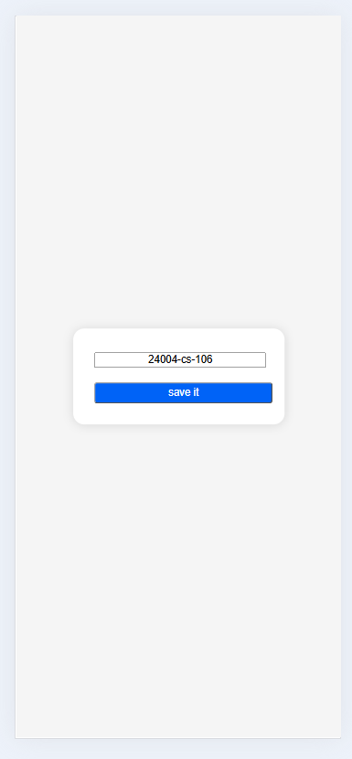
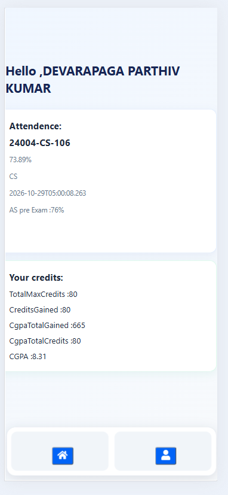
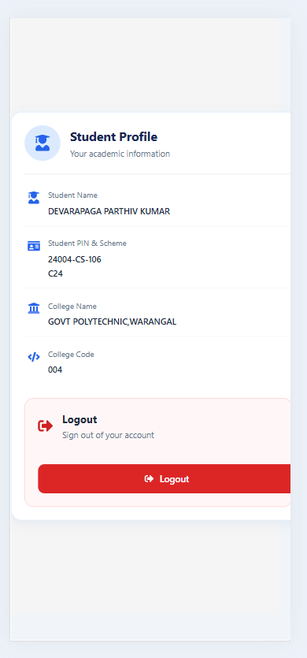

# GPT CAmpus
---
 It has three pages 1. collage pin  2.student attendance 3. basic information collage  
* This application used check their**attendance and credits of diploma students**
  

 ## features
---
* This application used check their** attendance and credits of diploma students**
* It is very clean ad useful student.
* simple and best user interface.
* sample to understand to every one.
* Responsive

---
 ## technologies
frontend: HTML ,CSS ,JS, REACT JS
**{use state,use effect,props , Router,rotes,navigate,icon, async-await,fecting,json parse-string,localstroage,regex}**

 --
## usage
---
 I had bulid one  application which is useful for only polytechnic students ,to check their   attendance and academic credits and basic information about of student.This application is very user-friendly and very sample to use the user .No ads like a Sbtet connect .Now the students no need re-type captcha code,and  no redirecting to another application. I hope that ,This application be helpful for you.

---
## how to run programme
- copy the git clone
 - by using of git commands run clone in teriminal
 - npm install
 - npm run dev in the teriminal .It will run local host
   or
   By givien link of application you can use .

   --
### update
- I will extra feature
 - I have update responsive

### what i learn in this application 
--

I have improved my css  skills{flex topice }.
after some days i used chatgpt for improve the desgin of application.
**{use state,use effect,props , Router,rotes,navigate,icon, async-await,fecting,json parse-string,localstroage,regex,try-catch}**
- Time mangament,improving javascript language,

-
 ## author
 - Mr. Parthiv kumar 
 - https://github.com/Parthiv-tech-git/GPT

 ---
 ## output 
--
[GPT CAmpus](https://gpt-eight-gules.vercel.app/)
---

---
 
